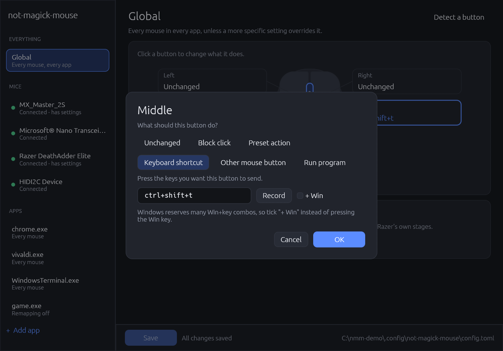
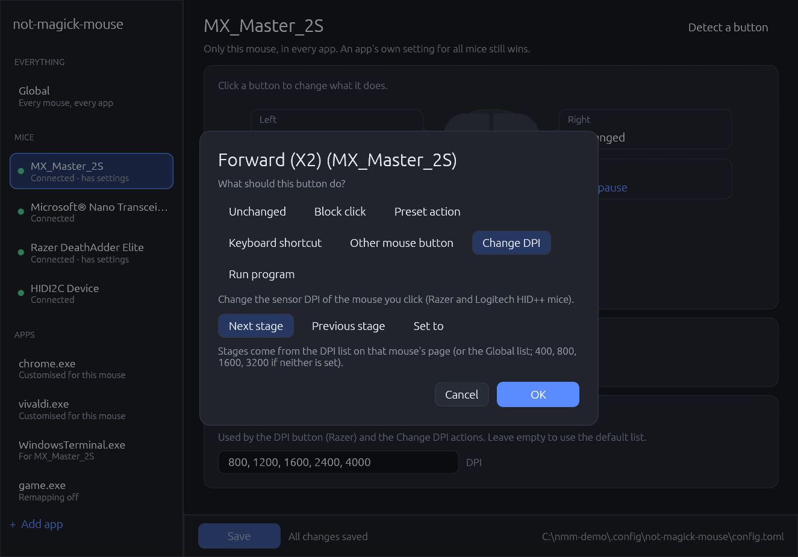
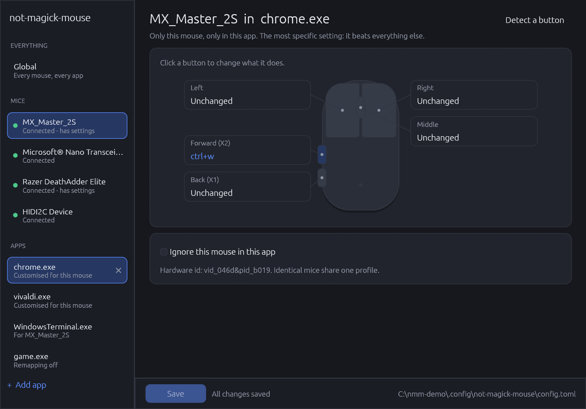

# not-magick-mouse

A tiny mouse button remapper for Windows and Linux with a tray icon, a simple config GUI, and (on Windows) custom DPI stages and a plain DPI on-screen display. Built for a Razer DeathAdder Elite without Synapse. See `PLAN.md` for design notes.

A fresh install remaps nothing. You map buttons yourself in the GUI.


| Per-mouse profile | Button editor |
|---|---|
|  |  |

## Repository layout

```
core/       platform-independent: config, actions, key names, profile resolution
gui/        the settings window `nmm-gui` (egui), shared by Windows and Linux
windows/    platform (hook, injector, tray, OSD, HID DPI), daemon `nmm`, installer, spike tools
linux/      platform (evdev/uinput, X11 focus, tray), daemon `nmmd`, packaging (.deb, .rpm, tarball, systemd unit, udev rule)
```

## Install (Linux)

The Linux build has the same settings window as Windows (`nmm-gui`) and a tray icon. The daemon `nmmd` runs as a systemd user service, shows the tray icon (Enabled, Settings, Reload config, Open config folder, Quit) and remaps the buttons. Download the package for your distribution from the release page:

| Distribution | Package | Install |
|---|---|---|
| Debian, Ubuntu, Linux Mint, Pop!_OS, ... | `not-magick-mouse_<version>_amd64.deb` | `sudo apt install ./not-magick-mouse_<version>_amd64.deb` |
| Fedora, RHEL / Rocky / Alma, openSUSE, ... | `not-magick-mouse-<version>-1.x86_64.rpm` | `sudo dnf install ./not-magick-mouse-<version>-1.x86_64.rpm` (`sudo zypper install` on openSUSE) |
| Any other distribution with systemd (Arch, Void, ...) | `not-magick-mouse-<version>-linux-x86_64.tar.gz` | `tar xzf ...tar.gz && cd not-magick-mouse-* && ./install.sh` (installs into `~/.local`, needs `sudo` once for the udev rule) |

The packages install `nmmd`, `nmm-gui`, a user service that is enabled for every user (it starts at the next login; or run `systemctl --user enable --now nmmd` right away), a udev rule (`72-nmm.rules`), an application-menu entry and the icon. The rule gives the logged-in user access to the mouse devices and `/dev/uinput`; the access is granted when your session starts, so **log out and back in (or reboot) once after installing**. The binaries are linked against an old glibc (2.31), so they also run on older distributions such as Debian 11 and RHEL 9. Only x86_64 is built for now.

Using it: open **not-magick-mouse** from the application menu or the tray icon's Settings entry, pick a button, choose an action, Save. The daemon reloads the file within a second. The config is the same `config.toml` as on Windows, under `~/.config/not-magick-mouse/`.

- **Tray icon:** KDE Plasma, Xfce, Cinnamon, MATE, LXQt and most other desktops show it out of the box. GNOME needs the "AppIndicator and KStatusNotifierItem Support" extension (Debian/Ubuntu package `gnome-shell-extension-appindicator`); without a tray host the daemon keeps remapping and you open Settings from the application menu.
- It grabs each mouse through evdev and re-emits events through uinput, so it works on X11 and Wayland. Access comes from udev seat ACLs (the `uaccess` tag) on your local session, so no `sudo` and no group membership are needed on a normal desktop login.
- **Permission denied** (the daemon logs it, `systemctl --user status nmmd`; typical over SSH or other sessions without a local seat): check `getfacl /dev/uinput` lists your user. If not, run `sudo usermod -aG input $USER` and log out and back in. The udev rule must be named so it sorts before `73-seat-late.rules` (it ships as `72-nmm.rules`); versions up to 0.4.0 shipped it as `99-nmm.rules`, which never got the ACLs on RHEL / Alma / Rocky 10, so upgrade to 0.4.1 or later.
- App profiles need X11 (or XWayland windows) to see the focused app; `exe` is the process name, e.g. `firefox`. On pure Wayland only the global and per-mouse layers apply, and the app picker in the GUI is empty (type the name instead).
- Mouse ids are `vid_xxxx&pid_xxxx`; the GUI lists your mice and shows the id.
- DPI actions and the DPI overlay are Windows-only (hidden in the Linux GUI; a hand-written DPI action in the config is logged and ignored). `win` means the Super key. Browser back/forward send Alt+Left/Right.
- While the editor waits for you to press a mouse button, remapping pauses so the click reaches the window unchanged.

Build from source: `cargo build --release -p nmm-linux -p nmm-gui`, then `BIN_DIR=target/release linux/packaging/install.sh`. To build the three packages yourself: `sh linux/packaging/package.sh` (needs `dpkg-deb` and `rpmbuild` for the .deb and .rpm; install `cargo-zigbuild` for the old-glibc build).

## Install (Windows)

### Installer (recommended)

Download `not-magick-mouse-<version>-x86_64-setup.exe` and run it (it asks for administrator approval, since it installs to Program Files). The wizard lets you choose the install folder and whether to start with Windows, and the last page has a "Start not-magick-mouse now" checkbox (ticked by default). It adds Start Menu shortcuts for the tray app and Settings, and an entry in Settings > Apps for uninstalling. Your config file is never removed. Upgrading is just running a newer setup. If you installed an older `.msi` version, uninstall it first.

Command-line options:

```powershell
.\not-magick-mouse-0.3.0-x86_64-setup.exe /S                              # silent, defaults
.\not-magick-mouse-0.3.0-x86_64-setup.exe /S /AUTOSTART=1                 # also start with Windows
.\not-magick-mouse-0.3.0-x86_64-setup.exe /S /CONFIGPATH=D:\nmm\config.toml
.\not-magick-mouse-0.3.0-x86_64-setup.exe /S /D=D:\Tools\nmm              # /D= must be last
& "C:\Program Files\not-magick-mouse\uninstall.exe" /S                   # uninstall
```

`/CONFIGPATH` makes the shortcuts and the autostart entry pass `--config` to the app.

### Portable

Unzip `not-magick-mouse-<version>-portable.zip` anywhere and run `nmm.exe`. Keep `nmm.exe` and `nmm-gui.exe` in the same folder, because the daemon opens the GUI from its tray menu.

### Build from source

Requires Rust (MSVC toolchain) and the Windows SDK (for the icon resource).

```powershell
cargo build --release -p nmm -p nmm-gui    # target\release\nmm.exe and nmm-gui.exe
cargo test -p nmm-core -p nmm-platform-windows -p nmm-gui
```

### Building the installer (on Linux)

The installer is an [NSIS](https://nsis.sourceforge.io/) script, so the whole Windows release can be built on Linux (also in WSL or Git Bash with the same tools). The exes are cross-compiled for `x86_64-pc-windows-gnu` with MinGW:

```sh
sudo apt install gcc-mingw-w64-x86-64-posix binutils-mingw-w64-x86-64 nsis zip
rustup target add x86_64-pc-windows-gnu
./windows/installer/package.sh          # writes dist/*-setup.exe, dist/*-portable.zip, SHA256SUMS-windows.txt
```

The installer definition is `windows/installer/nmm.nsi`.

## Use

1. Run `nmm.exe`. A tray icon appears. Right-click for Enabled, Settings, Reload config, Open config folder, Start with Windows, Quit.
2. Open Settings. The sidebar lists **Global**, every **mouse** Windows sees (green dot = connected) and your **app** profiles. Pick one, click a button on the mouse drawing (or its label), choose an action, OK, then Save (Ctrl+S). The tray app reloads automatically.
3. "Detect a button" lets you click the physical button instead of knowing whether it is X1 or X2. While detecting, remapping is paused so mapped buttons are detected too.
4. DPI stages: type values such as `800, 1600, 2400, 3200` on the Global page (default for every Razer mouse) or on a Razer mouse's own page. The DPI button then cycles through your list instead of the mouse's built-in stages. Leave it empty to keep the built-in stages.

### Changing DPI from a button

In the button editor choose **Preset action**, then one of the **Change DPI** entries at the bottom of the list: *next stage*, *previous stage* or *set to a value*. It acts on the mouse that was clicked, so a button on the MX Master changes the MX Master's DPI. Nothing is assigned by default; you choose the buttons (for example Back and Forward on the MX Master, set on that mouse's page).

- **Razer** mice: over Razer's HID protocol (as for the DPI button).
- **Logitech** mice (tested on an MX Master 2S over Bluetooth, range 200-4000 in steps of 50): over HID++ 2.0 "Adjustable DPI". Close Logitech Options+ / G HUB if they fight over the setting. Values are snapped to what the sensor accepts.
- Next/previous use the DPI list of that mouse (its page), else the Global list, else `400, 800, 1600, 3200`.
- The overlay shows the new value; it says "Mouse not identified" if Windows could not tell which of several DPI-capable mice you clicked.



### Several mice: how settings combine

The Settings window opens on **Global**, with no mouse selected. Every mouse is assumed to have five buttons (left, right, middle, back, forward), and what you set there applies to all mice in all apps. The sidebar then narrows the scope:

| You select | You are editing | Applies to |
|---|---|---|
| Global only | Global | every mouse, every app |
| a mouse | that mouse | that mouse, in every app |
| an app (no mouse) | global + app | every mouse, in that app |
| a mouse, then an app | mouse + app | that mouse, in that app only |

Picking an app keeps the mouse that is selected; click the mouse again to drop the app, or Global to clear both. The page title always says what you are editing (for example `MX_Master_2S in chrome.exe`).

When a button is pressed, the first layer below that sets it wins (most specific first). A layer only overrides the buttons it defines; anything left unchanged falls through to the next one.

1. this mouse in this app
2. this app (any mouse)
3. this mouse (any app)
4. Global

Example: Back on the Razer closes tabs in Vivaldi (Razer + Vivaldi), Forward on the MX Master closes tabs in Chrome but opens a new tab in Vivaldi (MX + Chrome, MX + Vivaldi), and Back on the MX Master opens an app everywhere (MX profile). Note that an app's setting for *all* mice (layer 2) beats a mouse's setting (layer 3), so use mouse + app (layer 1) when two mice must differ inside one app.

"Ignore" switches exist at every level: a mouse (works as normal everywhere), an app (remapping off in that app) and a mouse in an app.



Which mouse a click came from is read through Windows Raw Input. If Windows does not say (for example input injected by other software), the click is treated as coming from an unknown mouse and only Global applies, so remapping never stops working because of it.

DPI works for every connected Razer mouse independently. With more than one, the on-screen display names the mouse (`DeathAdder Elite: 1600 DPI`); with one it stays plain (`1600 DPI`). Mice plugged in later are picked up within a few seconds.

## Config location

Default: `%USERPROFILE%\.config\not-magick-mouse\config.toml` (created on first Save).

To use another file, in order of priority:

1. `--config <path>` on `nmm.exe` and `nmm-gui.exe`
2. the `NMM_CONFIG` environment variable
3. the path you set in the GUI (Settings > "Config file" > Apply). It is remembered in `%USERPROFILE%\.config\not-magick-mouse\location.txt` and both programs follow it. If the file exists it is loaded; otherwise it is created from your current settings. "Default" goes back to the standard location.
4. the default above

When `--config` or `NMM_CONFIG` is in effect the GUI shows the path read-only, because those override the saved one. The tray menu passes a forced path on to the GUI, and the installer's `/CONFIGPATH` option bakes it into shortcuts and autostart. The GUI shows the file in use at the bottom of its window. If the default file does not exist yet and an older `%APPDATA%\not-magick-mouse\config.toml` does, it is copied over automatically once.

A broken file never stops remapping: the daemon keeps the last good config and shows the error on the OSD.

## Config reference

```toml
[settings]
osd_ms = 1500
osd_position = "bottom-center"   # top|center|bottom + -left|-center|-right
dpi_poll_ms = 500                # 0 disables DPI detection and custom stages
dpi_stages = [800, 1600, 2400]   # empty = keep the mouse's own stages
start_with_windows = false       # the tray toggle and this setting stay in sync

[global]
x1 = "key:ctrl+w"

# Per-mouse profile. `id` comes from the GUI (see the "Hardware id" line on a mouse's page).
[[device]]
id = "vid_1532&pid_005c"
name = "Razer DeathAdder Elite"   # display only
dpi_stages = [400, 800, 1600]     # empty = use settings.dpi_stages
x1 = "key:ctrl+t"                 # only for this mouse
# disabled = true                 # leave this mouse alone

[[app]]
exe = "WindowsTerminal.exe"
x1 = "key:ctrl+shift+w"       # every mouse in this app

[[app.device]]                  # one mouse in this app (most specific)
id = "vid_046d&pid_b019"
x2 = "key:ctrl+t"
# disabled = true               # leave this mouse alone in this app

[[app]]
exe = "game.exe"
disabled = true
```

`docs/demo-config.toml` is a larger example.

Buttons: `left`, `right`, `middle`, `x1`, `x2`.

Actions: `passthrough`, `none` (swallow the click), `preset:<name>`, `key:<combo>`, `mouse:<button>`, `run:<command line>`, `dpi:next`, `dpi:prev`, `dpi:<number>`.

Combos are modifiers (`ctrl`, `shift`, `alt`, `win`) plus one key, e.g. `ctrl+shift+w`, `alt+f4`, `volume_up`.

Presets: `close_tab`, `close_tab_mdi`, `close_window`, `browser_back`, `browser_forward`, `play_pause`, `next_track`, `prev_track`, `mute`, `volume_up`, `volume_down`, `desktop_left`, `desktop_right`, `task_view`, `copy`, `paste`, `undo`, `redo`.

## Notes and limits

- Autostart follows `start_with_windows` in the config: if it is `true`, the daemon registers itself at sign-in each time it starts, regardless of the installer's autostart choice.
- A non-elevated daemon cannot inject input into elevated (admin) windows.
- Hooks and injected input can trip anti-cheat. Add a disabled profile for such games.
- DPI is read and written over Razer's HID protocol, verified on the DeathAdder Elite (PID 005C). The mouse will not store a custom stage list, so custom stages are applied by the daemon: after you press the DPI button it switches the mouse to the next value in your list within one poll interval (500 ms by default). Other Razer mice may or may not answer.
- DPI control exists for Razer mice and Logitech HID++ 2.0 mice. Other mice (Microsoft, touchpads) can be remapped per device but their DPI is not touched. The Razer DPI button handling (custom stages after pressing the mouse's own DPI button) is Razer-only; Logitech DPI changes only happen through the Change DPI actions.
- `windows/spike/` holds throwaway probing tools used to learn the HID protocol (`cargo run -p nmm-spike --bin dpi_test` changes your DPI temporarily).
- The icon is original artwork generated by `assets/make_icon.py`.

## Releasing (automated deployment)

- `.github/workflows/ci.yml` is the only workflow, and **pushing to `main` builds nothing**. It runs when you push a tag (`vX.Y.Z`), on pull requests and when started by hand, entirely on Linux: `nmm-core`, the Linux daemon and the GUI are built, unit-tested and clippy-checked, a job builds the Linux tarball, .deb and .rpm, and another cross-builds the Windows exes, the NSIS installer and the portable zip. The Windows unit tests (`nmm-platform-windows`, `nmm-gui`) run in a non-blocking job that executes the cross-compiled test binaries under Wine; if it is flaky, run `cargo test -p nmm-platform-windows -p nmm-gui` on Windows before releasing. There is no macOS build.
- On a tag the packaging jobs also check that the tag matches the crate version. When the tests and both packaging jobs pass, the `publish` job creates the Forgejo release through its API (`scripts/forgejo-release.sh`: notes from the commit subjects since the previous tag, files plus a combined `SHA256SUMS.txt` attached) and the `github` job mirrors it. It uses the built-in job token; set a `FORGEJO_TOKEN` repository secret with write access if that token cannot create releases. Forgejo ignores the workflow's `permissions:` block (it only logs a warning). To check a change without releasing, open a pull request or run the workflow by hand; neither publishes.

```powershell
# 1. bump `version` in core, windows/*, linux/* (and the path dependency versions)
# 2. commit, then:
git tag v0.3.0
git push origin main --tags
```

Every release is also published to GitHub by the `github` job: `scripts/mirror-to-github.sh` appends the new commits to GitHub's `main` with `.github/` removed (builds only run on Forgejo; nothing is force-pushed or rewritten) and pushes the tag, then `scripts/github-release.sh` creates the GitHub release and uploads the same files. One-time setup: add a repository secret `GH_PUSH_TOKEN` on Forgejo (a GitHub token that can push contents and create releases on `mabayhan/not-magick-mouse`). To mirror by hand, run `DRY_RUN=1 sh scripts/mirror-to-github.sh` first to see what would be pushed.

The workflows target a Forgejo instance with a Linux runner labelled `ubuntu-latest` (no Windows or ARM runners needed); they stick to actions available on `data.forgejo.org` (`upload/download-artifact@v3`, `actions/checkout`) so no third-party release action is used. To refresh the README screenshots run `.\windows\installer\screenshots.ps1` (it uses a throw-away demo config, not yours).
